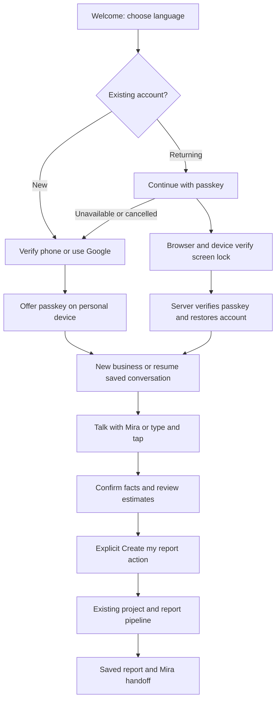

# Mira onboarding: repository audit and implementation plan

Prepared 2 November 2026. Branch: `operation-goldrush`. Audited after
`git pull --ff-only origin operation-goldrush` fast-forwarded `4aa694e` to
`77afa90`. This document proposes the replacement; it does not implement it.

The intended experience is a guided conversation with a visible, editable answer
summary. Passkeys provide convenient returning-user authentication. Mira collects
business facts; validated application code controls state, account access and
report submission. The financial engine remains a separate concern.

## 1. Current journey

```text
Landing
  -> /register: email + password + name; gender and phone also offered
       OR Google; evaluator demo also offered
  -> /wizard for a new account

/login: email/password OR Google OR evaluator demo
  -> existing businesses: /dashboard
  -> no businesses: /wizard

/wizard and /new-assessment, both protected
  -> 1 LGD Location and premises
  -> 2 Enterprise name, business category, sector and ODOP hint
  -> 3 Promoter identity, beneficiary category and gender
  -> 4 Cash, derived project outlay, machinery, turnover and preliminary DSCR
  -> 5 Loan terms
  -> 6 Business narrative and optional monthly income override
  -> 7 Review and run
  -> BusinessContext.createAndSaveBusiness
  -> POST /api/v2/projects/create-and-analyze
  -> persisted project + feasibility pipeline + persisted report/DPR
  -> /dashboard
```

The API prefix is configuration-driven; `/api/v2` above is the current default.
The route named `create-and-analyze` writes a draft before analysis; it is not a
database transaction covering the complete external-provider pipeline.

Mira is currently a separate floating assistant on the application shell. The
public landing/auth branch returns before that widget is rendered. Speech can
navigate report tabs, change UI language, open a new analysis or export a DPR.
It cannot currently fill the wizard, validate an answer, confirm a field or save
an onboarding conversation.

## 2. Findings from the current code

Severity describes importance for the proposed replacement, not a claim about a
tested production deployment. This is a static code audit; no accounts were
created, microphones exercised, provider calls made or production data changed.

| Priority | Finding and evidence | Consequence / planned treatment |
| --- | --- | --- |
| Critical | `backend/app/core/auth_dependency.py:61` accepts `test-token-` and `mock-token-` claims without an environment guard. `frontend/src/context/AuthContext.jsx:149` creates an email-derived UID and unsigned fallback token; invalid Firebase configuration can invoke this path for ordinary login/registration. | A polished screen-lock UI would not secure the existing alternate path. Restrict mock auth to an explicit local test environment; reject it in production. Firebase failure must not silently authenticate someone. Isolate evaluator data from real accounts. |
| High | `frontend/src/components/Wizard/FeasibilityWizard.jsx:35` initializes a named dairy, default promoter, West Bengal/Bankura/Joypur, gender, cash, cost, turnover and rent. | A fresh applicant can submit example facts as their own. New Mira drafts start blank except authenticated profile facts and explicitly labelled suggestions. Demo templates remain deliberate demo choices. |
| High | `frontend/src/pages/WizardPage.jsx:15` and `:23`, plus `frontend/src/context/BusinessContext.jsx:187` and `:221`, reset or submit English. | A user can speak one language and be moved back to English. Retain separate chosen UI, conversation and report language preferences end to end. |
| High | `FeasibilityWizard.jsx:160` derives machinery budget from 55% of project cost, can derive outlay back from machinery, and `:185` overwrites turnover with cost × sector multiplier × capacity factor. The effect does not depend on enterprise name, despite using it, and does not cancel for sizing-mode changes. | A renamed/different business can retain stale machinery; changed cost/sector can overwrite entered sales. Put preview calls behind a versioned draft and cancel stale responses. Show legacy estimates as estimates. Do not call this demand forecasting. |
| High | `FeasibilityWizard.jsx:983` rewrites available cash on a category change. `:1263` sets category to `women` through a concession shortcut; `:1276` sets cash to the equity requirement through a family-equity shortcut. | Eligibility and cash facts can change to fit financing. Mira must never infer or change identity/category, invent family contributions or increase cash to close a gap. Ask and confirm actual facts; keep financial options separate. |
| High | `FeasibilityWizard.jsx:1058` previews an assumed 90% loan at 8%; `:1067` floors income at zero and `:1071` caps preview DSCR at 5. | This preview is not necessarily the report's scheme-specific result. Do not teach Mira to quote these values as approved terms. Obtain a preview from the same calculation path as the report, or omit the ratio during onboarding. Financial-model changes require their own approved scope. |
| High | `frontend/src/context/BusinessContext.jsx:201`, `backend/app/models/schemas.py:259` and `backend/app/routers/projects.py:32` omit GPS and SCA-bridge intent from the persisted project-to-pipeline contract. | The wizard's submitted object is not the actual final report input. Define one adapter and explicit supported metadata; do not tell the user a selected option was applied if it was discarded. The meaning and eligibility of a bridge must be verified by the backend. |
| Medium | `FeasibilityWizard.jsx:354` advances steps without field validation. Required controls live on conditionally rendered steps. `:373` uses `value || default`, which turns a custom zero-month moratorium into a nonzero default. Rent uses similar fallback logic. | Validate every proposed patch and final submission on the server; distinguish zero, unknown and omitted values. Preserve legitimate zero values. |
| Medium | Form state exists in component memory. `BusinessContext.jsx:92` and `:169` automatically analyze existing project drafts when loading/switching them. | A refresh loses incomplete answers; reusing project `draft` for a Mira conversation could trigger analysis without final review. Add a separate onboarding-draft lifecycle. |
| Medium | `backend/app/routers/chat.py:174` accepts arbitrary client context/history and reads the uploaded audio; the inspected router has no user dependency or upload-size check. `backend/app/main.py:220` adds no router-wide auth dependency. | Reuse speech internals, not this route as an unrestricted draft-editing endpoint. New onboarding routes must authenticate, check ownership, bound audio/history and rate-limit provider calls. Deployment controls were not audited. |
| Medium | `LanguageContext.jsx:13` and profile language validation support six UI languages. The voice widget lists more, including Bengali. | Voice detection is not proof of complete UI/report support. Ship tested language packs with matching persistence; expand Bengali across all layers if chosen. Never advertise every detected language as fully supported. |
| Medium | `backend/app/database.py:160` and `:182` require an email, while a phone-only Firebase account may not have one. | Phone-first signup needs a schema/profile migration for absent email. Do not invent an official-looking email or merge accounts by name. |

What is worth keeping:

- Authenticated project ownership, session synchronization, business switching,
  saved report/DPR retrieval and the existing backend analysis entry point.
- LGD lookup APIs and explicit location review; ODOP and catalogue information as
  sourced suggestions, rather than user facts.
- `useVoiceRecorder.js`: permission handling, silence detection, manual stop/cancel,
  duration limit, audio cleanup and WAV/MediaRecorder fallback.
- Mira's avatar, listening/thinking/speaking states, transcript display and audio
  interruption patterns. Use them in a dedicated onboarding surface.
- Existing speech cascade: Sarvam language detection -> Bhashini ASR -> voice
  reply generation (Sarvam with Groq fallback) -> Bhashini TTS, with additional
  fallback paths. Comments mentioning only Groq do not fully describe the current
  implementation. Its configured provider credentials and actual latency still
  need runtime verification.

## 3. Proposed product journey



### Sign-in and account setup

Use one welcome screen instead of requiring people to understand separate login
and registration forms. Keep `/login` and `/register` as compatible entry URLs.

- Primary returning-user action: **Continue with screen lock**. Use passkey
  authentication through the browser's own credential picker. Supporting text:
  "Use your fingerprint, face or device PIN, where supported."
- New-user action: **I'm new**. Recommended target: verify a mobile number with
  Firebase Phone Auth; offer existing Google sign-in as an alternative. Existing
  email/password remains reachable under **Other ways to sign in** during rollout.
- Phone OTP is new work in this repository. It needs Firebase Phone Auth setup,
  authorized domains, reCAPTCHA, delivery/billing configuration, throttling and
  phone-only profile support. Do not expose a nonworking phone button before those
  prerequisites pass. Existing Google/email can bootstrap passkey enrollment first.
- After verified first sign-in, offer **Make next sign-in easier** -> register a
  passkey. Skipping or cancelling enrollment must preserve the authenticated
  session and allow onboarding to continue.
- Ask whether this is the user's personal device before enrollment. On a shared
  phone or assisted kiosk, prefer temporary sign-in and explicit sign-out; do not
  enroll a beneficiary's passkey into the helper's credential manager.
- Recovery: another linked passkey, a verified linked phone or an existing trusted
  provider. Add a passkey only after authentication and recent reauthentication.
  A new, unlinked phone number must never recover a named existing account.
- Account linking must prove control of both identities. Keep the existing
  `firebase_uid` and project ownership. Do not merge using spoken name, matching
  display name, client-supplied UID or an unverified email/phone.

**Passkey and screen lock are one mechanism here.** The platform verifies the
person locally and signs a server challenge. The application receives a public-key
assertion, never the phone PIN, fingerprint or face data. Mira should not claim
every device supports every verification method. Passkey providers can synchronize
credentials or offer another-device flows; do not promise a passkey lives on only
one phone. Production requires HTTPS and a stable relying-party domain.

### Mira's business conversation

Present Mira, one question, a transcript and an editable answer card. Offer
**Speak**, **Type instead**, **Repeat**, **Change an answer**, and **Save and exit**.
After choosing voice, request the microphone on a user action. Do not request it
to sign in. Keep ordinary controls usable with no microphone, TTS or LLM.

Order of collection:

1. Language and voice-processing choice; the user can switch mode at any time.
2. Business idea in their words, and whether the business is new or operating.
   Suggest category/sector from the supported taxonomy and confirm it. A dairy
   shop, dairy farm and milk processing unit are different activities.
3. Business site: village/town, district and state, resolved against LGD choices.
   Request device location only as an optional hint, never as proof of worksite.
   Ask whether the proposed site is rural/urban if not reliably resolved.
4. Personal cash actually available; separately ask about a total project budget
   if they know it. Confirm rupees/lakh/crore and one-time versus recurring money.
5. Premises: rented/owned/panchayat, actual monthly rent and known utilities.
6. Relevant operating facts: product/service unit, current equipment, customer
   channels, staff and schedule when known. Tailor questions to the business.
7. Display name/legal promoter name and explicitly self-declared scheme-relevant
   category/gender when required. Explain purpose, offer private tap/type input,
   and never infer these from voice or name. A skipped category is unassessed,
   not automatically a confirmed General declaration.
8. Sales branch: operating business -> ask for actual sales with time period and
   source; new business -> ask only known buyers/orders, volume/price and channel
   facts. "I don't know" remains unknown. The current branch's cost-multiple sales
   estimate, if used, must be labelled a legacy estimate and confirmed as such.
9. Known bank terms or clearly labelled suggested terms; do not require people to
   understand moratorium or DSCR to finish. No promise of bank approval/subsidy.
10. Read back confirmed facts, show every assumption and any shortfall, then ask
    for an explicit final action. Do not create or analyze a project from silence.

This is an adaptive conversation, not seven pages read aloud. A user may provide
several answers in one turn; record candidate facts, confirm important values,
and ask only for what is missing. There is no fixed question count or unmeasured
promise of a three-minute completion time.

## 4. State, data and responsibilities

Keep conversation state separate from the existing dashboard chat history and
from analyzed projects. Suggested state machine:

```text
WELCOME -> AUTH -> RESUME_OR_NEW -> IDEA -> LOCATION -> CASH -> PREMISES
        -> OPERATIONS -> PROFILE -> SALES_CONTEXT -> TERMS -> REVIEW
        -> SUBMITTING -> COMPLETED

Any collection state -> NEEDS_CLARIFICATION / PAUSED / TEXT_MODE
Any edit -> invalidate affected derived suggestions -> REVIEW again
```

Backend rules choose the next required question. Mira cannot skip required checks
by returning a different `next_step`. Stop recording before authentication,
passkey, OTP and sensitive profile panels. Do not send authentication material
to speech or language providers. Passkeys are not voice authentication.

Each answer records:

```json
{
  "field": "available_margin_capital",
  "value": 40000,
  "unit": "INR",
  "source": "user_speech",
  "source_turn_id": "turn-12",
  "status": "pending_confirmation",
  "interpretation": "Forty thousand rupees of personal cash available now",
  "uncertainty": "none_detected",
  "confirmed_at": null
}
```

Statuses distinguish `unknown`, `proposed`, `pending_confirmation` and
`confirmed`. An LLM confidence number is not calibrated evidence. Resolve
ambiguity with the user. API/dataset evidence and system-derived numbers carry
source/version separately; they never masquerade as confirmed user statements.

Allowlisted, schema-validated LLM output may contain extracted answer proposals,
ambiguity notes, a proposed category/sector, and a short spoken sentence. It must
not set account ownership, identity verification, authorization, final loan
approval, project status, DSCR, API URLs or executable actions. The application
validates units, enum membership and source turns, then commits accepted patches.

Draft structure should contain `draft_id`, server-derived owner UID, version,
schema version, selected languages, current question, answer records, pending
confirmations, unresolved fields and preview version. Every mutation carries a
turn ID and expected draft version. Retries are idempotent; stale transcription,
LLM and machinery responses cannot overwrite newer corrections.

Changing business/site/budget invalidates dependent machinery and financial
suggestions. Changing category must not change actual available cash. Changing
site must clear inconsistent lower LGD selections. Keep LGD IDs and display names
together. Validate the proposed worksite independently of the phone's coordinates.

### Mapping to the existing report contract

| Collected or suggested information | Existing destination / migration need |
| --- | --- |
| Idea and confirmed enterprise label | `business_name` -> `enterprise_name`; narrative in `additional_business_details` |
| Confirmed category and sector | Existing `business_category`, `sector`; validate supported values |
| Confirmed place | Existing state/district/block/village names; add durable LGD IDs and optional GPS metadata |
| Cash available now | `available_margin_capital`; UI may retain `margin_capital` only as an adapter alias |
| Calculated/confirmed project cost | `project_cost` and existing `investment_amount` alias; never equate with available cash |
| Premises and rent | `premise_type`, `monthly_rent`; preserve zero and unknown distinctly |
| Actual or estimated annual sales | `annual_turnover_estimate` with an explicit source/mode in metadata; zero is not a missing-value sentinel |
| Name, self-declared eligibility facts | Existing promoter fields, without automatic concessions; represent unanswered separately before submission |
| Confirmed/default loan terms | `tenure_years`, `moratorium_months`, with provenance; zero moratorium stays zero |
| Language | Existing `language` plus explicit conversation/report preferences; remove forced-English transitions |
| Staff, schedule, business stage, sourced evidence | Onboarding metadata until the downstream contract explicitly accepts them; not silently discarded or claimed as applied |
| Possible bridge finance | Separate user intent and a verified finance decision; currently not preserved end to end |

Create one tested adapter from confirmed draft to `ProjectCreate`. Existing
required numeric inputs must be supplied by confirmed facts or explicitly labelled
system estimates. Do not send an unknown as zero, `NaN`, fabricated turnover or
an invented budget to satisfy a required schema field. Where an essential input
cannot be established, preserve the draft, explain the unresolved input and
offer manual entry. Voice/provider failure must not prevent a user with complete
inputs from generating a report.

An immutable review snapshot/hash binds the confirmed inputs and preview.
Submission uses an idempotency key bound to owner + draft + review version. Save
the resulting project ID before retrying analysis. Resume a failed analysis on
that project; do not create duplicates or auto-analyze unfinished conversations.

## 5. Proposed implementation boundaries

### Frontend

- Add `MiraOnboardingPage`, a dedicated onboarding reducer/context, transcript and
  answer cards, native-auth panels, and a plain form view of the same draft.
- Replace the beneficiary wizard entry at `/wizard` and `/new-assessment`; retain
  an advanced form route during migration. Both views use the same validated draft
  and final adapter. View-mode toggles are display preferences, not authorization.
- Add a passkey client using the browser credential API through a maintained
  wrapper, plus `signInWithCustomToken` in the existing Firebase client/context.
  Feature detection and cancellation keep alternate sign-in accessible.
- Reuse recorder/audio UI primitives, but isolate onboarding history and tools
  from report-chat tools. Only one recorder and one speaker may own audio at once.
- Start with tap-to-speak. Offer conversational auto-listening only after explicit
  choice, with pause/stop and clear indicators. Ignore speech recorded before the
  current question/version; avoid transcription of Mira's own playback.
- Browser autoplay denial/TTS failure leaves captions and controls working.
  ASR failure leaves typed answers working. Provider failure offers retry/manual
  mode on the same draft, not a fabricated answer.

### Backend and storage

Proposed routes, relative to the configured API prefix:

| Route | Responsibility |
| --- | --- |
| `POST /auth/passkeys/register/options` | Verified user + recent auth; create a single-use enrollment challenge |
| `POST /auth/passkeys/register/verify` | Verify enrollment and bind credential to the authenticated UID |
| `POST /auth/passkeys/authenticate/options` | Rate-limited public challenge; discoverable credential selection |
| `POST /auth/passkeys/authenticate/verify` | Verify assertion, consume challenge and issue a Firebase custom token for the stored owner |
| `GET /auth/passkeys`, `DELETE /auth/passkeys/{id}` | Owner-only credential management, recent auth for removal |
| `POST /onboarding/drafts`, `GET /onboarding/drafts/{id}` | Create/resume an owned conversation |
| `PATCH /onboarding/drafts/{id}` | Validated manual edits, confirmations, language and expected version |
| `POST /onboarding/drafts/{id}/turns` | Authenticated bounded audio/text turn; extract proposals, validate, return next question |
| `POST /onboarding/drafts/{id}/preview` | Existing calculator/report-compatible preview, versioned and labelled |
| `POST /onboarding/drafts/{id}/submit` | Confirmed review + idempotency; existing project/report workflow |

Store onboarding drafts in a separate table, not existing automatically analyzed
project drafts. Add credential and challenge tables, with owner FK and cascade
deletion consistent with account deletion. Migrate both PostgreSQL and the local
SQLite fallback. Never let an unavailable production database silently turn
identity challenges into an unshared, in-memory authentication authority.

Credential records need an opaque user handle, credential ID, public key,
transports, counter/backup metadata, label, created/last-used/revoked timestamps.
Unique credential IDs cannot be rebound to a second account. Do not store device
PINs, private keys or biometrics. Handle synchronized credentials and zero counters
according to the selected library's guidance; do not reject all synced passkeys
using a simplistic increment-only counter rule.

Use a maintained Python WebAuthn verifier; do not implement signature validation
manually. Registration/authentication must verify the single-use challenge,
expected origin, RP ID, signature/type and required user verification. Require
discoverable credentials for username-free sign-in. Prefer platform authenticators
for the simple device experience without unnecessarily excluding supported
credential providers/another-device flows. Attestation should not request device
identity without a specific requirement.

Challenges expire after a short documented interval (proposed five minutes), are
bound to the initiating ceremony/session, have distinct purposes and are consumed
atomically. Use same-origin deployment/proxy where practical; configure RP ID and
explicit allowed frontend origins per environment. A new random preview hostname
must not silently become a different relying-party identity. Rate-limit starts,
verifications, OTP and speech processing. Return non-enumerating account errors.

After a valid passkey assertion, Firebase Admin mints a custom token for the
credential's stored UID. The client exchanges it with `signInWithCustomToken`,
then existing ID-token validation and session synchronization apply. A custom
token is not the bearer ID token accepted by project APIs. Production Firebase
failure returns a recoverable sign-in error; it must not select mock auth.

For voice, reuse transcription/synthesis internals while introducing an
onboarding-specific prompt and allowlist. Fetch authoritative draft/evidence on
the server. Bound file size, duration, MIME handling, turn/history length and
overall provider deadlines. Do not log sensitive transcripts by default. Persist
only necessary structured facts and a disclosed transcript policy; discard raw
audio after processing by default, subject to actual provider retention settings.
On-screen voice consent must accurately state which external services receive
audio/text. Do not promise provider retention guarantees that have not been checked.

## 6. Build sequence and acceptance gates

1. **Authentication foundation.** Guard/remove production mock fallback, verify
   Firebase configuration, preserve existing UID/project ownership, separate demo
   data. Add passkey tables, challenges and Firebase token bridge. Migrate nullable
   email/profile responses before enabling phone-only accounts. Add OTP only when
   its provider configuration and recovery/linking behavior are verified.
2. **Canonical draft and text journey.** Implement blank, owned, versioned drafts,
   LGD disambiguation, validators, cash/outlay separation, language persistence,
   confirmations and review. Make the complete journey work without AI/audio.
3. **Mira voice collection.** Integrate ASR -> schema-bound extraction -> validated
   patch -> deterministic next question -> caption/TTS. Use the script in the
   companion document, with small contextual variations rather than free-form
   financial advice. Add interrupt/retry/manual-mode behavior and stale-turn guards.
4. **Preview and report handoff.** Map the draft once, label financial assumptions,
   compare review inputs with actual saved pipeline inputs, and make create/analyze
   idempotent. Saved draft, same-account resume and analysis retry must work.
5. **Rollout.** Feature-flag the new journey; compare completion, corrections,
   abandonments, provider failures/latency and duplicate-project rates. Keep a
   working form path and existing accounts. Enable tested language/device cohorts
   first; retire the old beneficiary wizard after acceptance, not immediately.

Focused acceptance tests:

- Correct and rejected WebAuthn ceremonies: expired/replayed challenges, wrong
  origin/RP ID, absent user verification, forged UID, duplicate enrollment,
  registration without recent auth, deleted credentials, cancelled browser picker.
- Production rejects test/mock tokens; existing trusted login still opens the same
  user's reports. Failed enrollment or Firebase sync does not manufacture a user.
- New/returning/phone-only users, account linking, lost device, multiple passkeys,
  shared-device logout and session expiry during a conversation.
- Chrome/Android, Safari/iOS and Windows Hello on real supported devices; browser
  unsupported/no-screen-lock/cancel paths keep alternatives available. Verify
  microphone and autoplay behavior on those browsers, not only desktop emulation.
- Named-village ambiguity; device location differs from worksite; LGD changes
  invalidate descendants; no default dairy/name/location appears in a real draft.
- Indian money phrases (forty thousand, one and a half lakh, dedh lakh), monthly
  versus yearly sales, turnover versus profit, legitimate zero rent/moratorium,
  negative/invalid values, corrections and multi-answer turns.
- Category changes never invent cash or alter self-declarations. Unknown facts
  remain unknown; model-generated assumptions are visibly labelled.
- Refresh/resume, slow ASR after a correction, two tabs, retry/double-submit and
  provider timeouts do not lose answers, apply stale patches or duplicate projects.
- Voice denied/unavailable, noisy input, ASR/TTS/LLM failure, slow network and
  code-switching complete through the same manual controls and report pipeline.
- Existing report-input fixtures produce identical normalized values and financial
  results through the new adapter unless a separate approved calculation change
  explicitly updates the fixture. Test reviewed draft versus persisted input.

## 7. Decisions adopted for this proposal

- A responsive web flow, using the current React/FastAPI/Firebase stack.
- Passkeys for convenient returning access; verified bootstrap and recovery remain
  available. Phone-first is a proposed addition, not an existing feature.
- English source copy and a Hindi/Hinglish sample script; support the six existing
  UI languages only after each path is tested. Bengali is a separate full-stack
  language addition if required.
- One adaptive Mira conversation plus a plain manual alternative. No obligation
  to speak financial or sensitive identity answers aloud.
- This phase changes collection and access. It does not replace the financial
  calculator, invent demand or promise a target DSCR. Legacy sales assumptions
  identified above need a separate financial workstream.

## 8. Primary implementation references

- [Google: server-side passkey registration](https://developers.google.com/identity/passkeys/developer-guides/server-registration)
  describes options, credential verification and public-key storage.
- [Google: server-side passkey authentication](https://developers.google.com/identity/passkeys/developer-guides/server-authentication)
  describes challenges, RP/origin checks, signatures and user verification.
- [W3C WebAuthn Level 3](https://www.w3.org/TR/webauthn-3/)
  defines the credential ceremonies and verification requirements.
- [Chromium: WebAuthn origins](https://chromium.googlesource.com/chromium/src/+/main/content/browser/webauth/origins.md)
  documents secure origins and local development exceptions.
- [Firebase custom authentication](https://firebase.google.com/docs/auth/web/custom-auth)
  documents the custom-token exchange into Firebase authentication.
- [Firebase Phone Auth](https://firebase.google.com/docs/auth/web/phone-auth)
  documents phone verification and reCAPTCHA setup for web clients.

References checked during this audit on 2 November 2026. Infrastructure readiness,
provider settings, costs and speech quality remain implementation-time checks.
